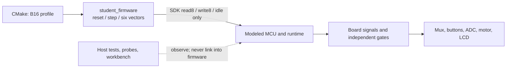

# Runtime and interface architecture

## Separation of authority

The B8 supplier reference specifies registers and timing. The Half-A/Labs/Mara correspondence
specifies product behavior. `requirements/correspondence.json` is a copy of the current message
source; the final clarification and approval in each thread has precedence. Tests reference message
IDs. Historic scan periods, fixed tach windows, numeric internal fault bits and fixed ADC
plausibility bands are not resurrected as hidden requirements.

The platform and emulator do not decide the product's ST, TH, TS, IF, IL, CK, WD or DM policy.
Hardware independently supplies reset, watchdog/deadman expiry, physical STOP and jar permission. It
does not quietly remove drive merely because a test injected a jam or hot case; such an
auto-protection shortcut would let bad firmware pass.

```text
Firmware (.cpp; SDK headers only)
    read8 / write8 / idle + reset / step / ISR table
        |
Host-only RegisterBackend binding
        |
Runtime: service boundaries, IRQ delivery, reset unwinding
        |
B8 MMIO and clocks
        |
GPIO, PWM, tach edges, analog voltage, external byte transactions
        |
Board-owned nets and replaceable component implementations
        |
Physical fixture controls / scenarios / optional link adapter
```

## Firmware surface

The 62 register addresses and B8 interface revision 03 are unchanged. `read8(Reg)`,
`write8(Reg,uint8_t)` and `idle()` remain the stable signatures. `firmware.hpp` declares the three
firmware entry points. `access.hpp` adds typed pairs for latched reads and staged writes, plus
single-source interrupt acknowledgment. It deliberately does **not** add a generic read-modify-write
helper that could corrupt W1C or strobe registers.

A byte-pair helper does not make two transactions atomic. An ISR accessing the same high-byte latch
can still interfere. Firmware must own the pair or protect the sequence. Clock unlock is invalidated
by intervening register accesses; helpers do not bypass that rule. None of these helpers knows about
buttons, RPM, temperature, displays or the jar.

`host::RegisterBackend` is outside the firmware include tree. A thread-local `ScopedBinding`
connects the ABI to one backend. Nested bindings are rejected; unbound accesses throw.
Boards/runtimes are not internally thread-safe. Separate firmware tests run in separate processes
because firmware globals are not automatically isolated between C++ objects or reconstructed on
reset.

## B16 learner integration architecture

The starter is still one incomplete firmware translation unit. The following is a decomposition
guide for Astin's work, not a claim that the application modules already exist. Keep the device
boundary in the existing CMake targets: `student_firmware` sees the SDK and its selected firmware
directory; `blender8_sim`, host probes and physics stay on the host side.



As the learner composes the application, keep these responsibilities distinguishable even if they
remain small functions in the starter directory:

| Responsibility           | Input and output seam                                                                                | Current status and evidence                                                                             |
| ------------------------ | ---------------------------------------------------------------------------------------------------- | ------------------------------------------------------------------------------------------------------- |
| Acquire and validate     | Electrical contacts or completed peripheral result -> stable, fresh value or explicit invalid status | Device behavior exists in the model; scan/acquisition firmware is unfinished.                           |
| Normalize commands       | Valid mux contact -> speed/PULSE/STOP intent                                                         | `platform/labs/b16/` has a TODO pure contact mapper; it does not scan or debounce.                      |
| Convert subsystem values | ADC code -> nominal temperature estimate; positive target -> duty fraction                           | TODO temperature and motor helpers exist as isolated host exercises. They do not read ADC or write PWM. |
| Decide application state | Startup, command, independent inhibit, sensor validity, and fault -> permitted or inhibited state    | Not implemented in the supplied learner firmware; preserve the customer recovery contract.              |
| Apply outputs            | Permitted request -> PWM/enable and bounded display update                                           | Output registers and simulated components exist; the product control path remains an exercise.          |
| Schedule and supervise   | Timer/IRQ events plus foreground progress -> bounded work and useful monitor service                 | Peripheral conformance tests exist; learner timer/ISR/WDT/DMT composition is unfinished.                |

These are boundaries for learning and review, not fixed class names or a prescribed controller
algorithm. Begin with the pure host helpers, then exercise one SDK operation through the lab's
scripted `RegisterBackend` fake and inspect its ordered byte trace. The fake checks driver
transactions only; it does not model ADC time, electrical behavior, or W1C semantics. Use the
platform model for peripheral conformance, then compose the operation into selected B16 firmware
and verify it with the named acceptance case. The host harness is not linked into
`student_firmware`; firmware changes must still pass the B16 numeric and include-boundary checks.

For the ordered source/manual inventory, concrete C++ milestones, harness status, and expected
observations, follow the [B16-first subsystem walkthrough](B16-FIRMWARE-LAB.md). Keep the results
separate: model CTests establish peripheral/platform behavior, `accept --case ...` runs the selected
firmware, and scenario replay/workbench observations show integration behavior. The isolated lab
tests are not product acceptance. B8 remains the later stretch profile.

The source bundle excludes the solution-only candidate-view test. Its `SOURCE-INVENTORY.json`
reports `firmware_solution: false` only when every non-README file under `firmware/` matches the
shipped safe-starter fixture; other inputs are marked `null` / `unknown`. This narrow byte comparison
does not attest the provenance of other bundled files, build settings, or generated binaries.

## Time and ordering

Logical time is an unsigned 64-bit microsecond count. `Board::advance` advances in one-microsecond
quanta. It checks overflow and rejects recursion. At each quantum:

1. Advance the world timestamp and apply scheduled physical changes. Equal timestamps preserve
   insertion order.
2. Advance supply qualification and external oscillator. Apply power/reset transitions.
3. Advance MCU clocks, timer/ADC/PWM and execution monitors.
4. Settle contacts, mux and jar permission, then the independent motor-enable gate.
5. Advance the motor and sensor; the thermal plant uses its defined update cadence.
6. Advance display row scanout and latch tach/VBLANK edges.
7. Return to the runtime, which can dispatch a pending interrupt at the next SDK service
   opportunity.

Events scheduled exactly at `now` apply immediately; past events and recursive event callbacks are
rejected. Events are applied even when a firmware callback executes many SDK operations. The UI and
scenario engine cannot move hardware events to a convenient callback boundary.

B8 bus accesses occur at the current service boundary, followed by one world microsecond and an
interrupt opportunity. Ordinary native arithmetic is not charged fictional instruction cycles.
Timer/PWM/ADC depend on peripheral frequency; DMT depends on divided system frequency; WDT and
missing-clock detection use independent LFRC. Mux delay, LCD refresh, motor inertia and sensor lag
are world-time quantities, not accidentally scaled by PBCLK.

A `run_for` request can overshoot its endpoint by the remainder of one bounded callback. Responses
include actual logical time. Timed events still occur at their precise microstep inside that
callback. Deadline tests use recorded transition times and do not assume requested time equals
returned time. State readers do not advance time or acknowledge registers.

## IRQ and reset execution

The B8 fixed-priority vector table has five sources. B16 retains those five and appends DMAC as
vector six; the SDK's `b8::VectorTable` reflects the selected profile. Entry masks global delivery,
nesting is unsupported, and each handler must acknowledge only its source. Flags coalesce; they are
not a queue. Host observation includes monotonic per-vector delivery counts so a live timer ISR can
be distinguished from a merely enabled source.

Runtime reset entry persists across successive `run_for` calls. UI chunking is not reset. Only a new
hardware reset epoch invokes `firmware::reset` again. A reset during an ISR abandons the interrupted
context and cannot restore the old global-interrupt state. A short source interruption or released
core-halt resumes the pending SDK operation without inventing a reset.

On reset the firmware must reinitialize its own global/static state in `reset`; native static
constructors do not run again. MCU reset does not erase the motor's heat/momentum, panel latches,
sensor temperature or warm external display. A supply loss has its separate external-device power
behavior.

## Host failures versus target failures

The callback service budget defaults to 150,000 SDK operations. Exceeding it latches a host failure
and removes the host-side enable gate; it is not recorded as WDT. It is configurable by the host,
not firmware. A nonreturning function with no SDK accesses cannot be preempted by this cooperative
runtime. The Python process client enforces a wall-clock response timeout and kills that process,
again reported as HOST_CALLBACK_TIMEOUT rather than target reset.

`halt 1` stops the modeled core while board time, LFRC and WDT continue. `foreground 0` suppresses
only future step calls; SDK idles still dispatch interrupts. These distinct injections support
genuine core-halt and live-tick/lost-foreground tests. Neither silently fixes incorrect
watchdog-service policy.

## Observation and trace ownership

`Mcu::observe`, display/motor/sensor probes and board observations are host capabilities. They never
call side-effecting MMIO getters. Reading a snapshot does not clear ADC READY, overwrite a high-byte
capture, disturb clock keys or acknowledge IRQs. Physical sources lacking a probe produce null
instrumentation instead of fabricated truth.

Per-step observers record important signal transitions. Trace sampling has explicit record and
duration limits; overflow fails instead of silently dropping the event that would prove a timing
violation. Optional bus CSV records timestamp, read/write, address, data and reset epoch. All UI
work is out of the firmware target.

## Platform 0.5.0: shared host session and Wasm route

`Session` owns the existing Board and Runtime, and implements the existing fixture-command protocol.
Native stdin/stdout and the C ABI both call this same class. `wasm/api.h` is host-only; it is not a
firmware interface. The browser workbench uses an injected NativeTransport or WasmTransport, never
its own physical model. WasmTransport executes within a dedicated module worker and uses serialized
sequence-tagged messages; termination is a host failure, not a modeled reset. See `WASM.md` for
build, lifecycle, precision and verification limits. This release contains source targets, not
verified compiler outputs.
